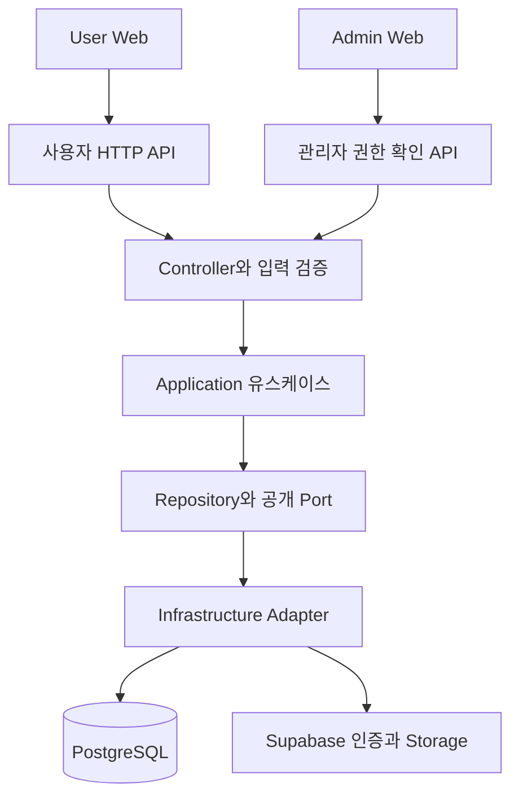
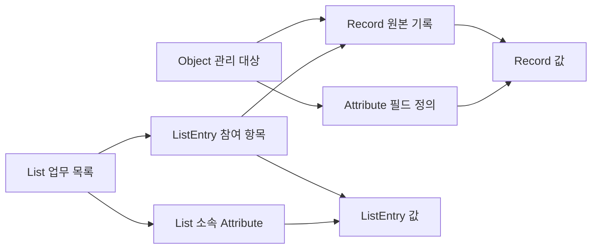

# OneHand CRM 개발 회고와 포트폴리오 보존 기록

- 작성일: 2026-11-14
- 상태: 서비스 사업화와 신규 기능 개발 보류, 현재 결과물 포트폴리오 보존
- 코드 기준: `4566c34a`, 2026-11-12 마지막 커밋
- 결정 기준: 개발자의 2026-11-14 대화와 [포트폴리오 보존 결정](../DECISIONS/035_project_pause_and_portfolio_preservation.md)

OneHand CRM은 사용자의 업무에 맞는 CRM을 처음부터 준비해주는 서비스를 목표로 개발한 프로젝트다. 현재는 인증과 Workspace, 유연한 관리 항목과 기록, 표·보드·목록, 보기 설정 저장까지 구현한 상태에서 개발을 보류한다. 도메인 이해와 고객 요구에 대한 판단 근거가 부족하고, 넓어진 범위에 비해 사용자가 이 제품을 선택할 이유가 충분히 구체화되지 않았기 때문이다.

현재 코드를 포트폴리오와 기술 참고 자료로 남기고, 새로운 프로젝트에서 필요한 기능이나 설계 경험을 활용할 가능성을 열어둔다. 재개 시점이나 다음 프로젝트는 확정하지 않는다. 아래의 미완성 항목은 보존 시점의 경계를 설명하며, 추가 개발을 약속하는 작업 목록이 아니다.

## 1. 만들려고 했던 서비스

### 1.1 해결하려던 문제

고객, 상담, 계약, 후보자, 매물처럼 서로 연결된 정보를 관리하는 사람은 업무마다 필요한 항목과 진행 상태가 다르다. OneHand CRM은 이러한 사용자가 도구의 구조를 직접 설계하는 부담을 줄이려 했다.

핵심 제품 문장은 다음과 같았다.

> CRM을 배우거나 설계할 필요 없이, 내 일에 맞는 CRM이 바로 준비된다.

가입 후 업무 유형을 선택하면 필요한 관리 대상, 정보, 관계, 상태, 기본 화면을 묶은 **Kit**을 제공하고, 사용자는 바로 첫 기록을 남기는 흐름을 구상했다. 이후 업무가 달라지면 관리 항목과 정보를 추가할 수 있도록 유연한 코어를 설계했다.

예를 들어 부동산 중개에는 고객·매물·방문·계약, 채용에는 후보자·회사·채용공고·인터뷰를 준비하는 방식이다. 이는 기획상의 예시이며, 현재 코드가 해당 업종의 Kit을 자동 생성한다는 뜻은 아니다.

### 1.2 제품 방향의 변화

| 단계 | 당시 방향과 산출물 | 보존 시점의 해석 |
| --- | --- | --- |
| 초기 OneHand Sales | 고객사·담당자·상품·딜 중심 영업 관리와 일정, 회의록, AI 관련 계획·작업 기록 | 과거 개발 이력. 완료 폴더에 있다는 이유로 현재 기능에 포함하지 않는다. |
| 2026-09-12 방향 전환 | 제품명을 OneHand CRM으로 정리하고 Kit 기반 No Setup CRM을 제품 방향으로 결정 | 특정 영업 구조에서 여러 업무를 표현할 수 있는 구조로 범위가 넓어졌다. |
| 이후 CRM 코어 구현 | Workspace, Object, Attribute, Record, List, View 및 생성·조회·설정 화면 구현 | 보존할 현재 기술적 결과물이다. |
| 2026-11-14 보류 | 현재 상태를 포트폴리오로 남기고 새 프로젝트와의 연결 가능성 보존 | 추가 사업화와 기능 확장을 계속해야 한다는 전제를 내려놓는다. |

초기 기능의 흔적은 [완료 작업 기록](../../../TODO/DONE/), 전환 결정은 [032 제품 피벗](../DECISIONS/032_product_pivot_to_no_setup_crm.md), 현재 제외된 고정 도메인은 [레거시 제거 기록](../../SOFTWARE_AGENT/DB_SCHEMA/LEGACY_REMOVED_DOMAINS.md)에 남아 있다.

### 1.3 목표와 현재 결과물의 차이

기획의 중심은 **사용자의 업무를 이해해 적절한 CRM을 준비하는 경험**이었다. 현재 결과물의 중심은 **사용자가 관리 항목과 속성을 만들고 기록과 보기를 구성할 수 있는 기술 기반**이다.

이 차이는 온보딩에서 구체적으로 드러난다. 현재 직업 선택 화면은 선택한 직업 값을 서버로 보내지 않는다. 서버는 온보딩 완료 시각을 저장하고 OWNER Workspace가 있도록 처리한다. 직업별 Object·Attribute·Relationship·View를 적용하는 Kit 로직은 없다. Workspace 홈도 현재 빈 화면이다.

따라서 이 프로젝트는 CRM 기반 구현과 설계 경험을 설명하는 포트폴리오로 제시한다. ‘직업에 맞는 CRM 자동 구성’은 당시 목표이자 미완성 범위로 설명한다.

근거: [온보딩 화면](../../../FE/user-web/src/pages/onboarding/index.tsx), [온보딩 API 호출](../../../FE/user-web/src/features/auth/api/auth-api.ts), [온보딩 유스케이스](../../../BE/src/modules/user/application/use-cases/complete-job-selection-onboarding.use-case.ts), [Workspace 홈](../../../FE/user-web/src/pages/home/index.tsx).

## 2. 보존 시점의 구현 범위

여기서 ‘구현’은 현재 소스에서 API 또는 화면 연결을 확인한 범위다. 테스트 결과와 실제 외부 서비스 연결 검증은 8절에서 구분한다.

| 영역 | 현재 구현 | 남아 있는 경계 |
| --- | --- | --- |
| 인증과 세션 | 외부 OAuth 인증 결과의 앱 토큰 교환, 앱 세션 확인, refresh token 회전, 로그아웃 | 외부 provider 설정과 연결 상태는 실행 환경에 의존한다. |
| 계정 | 프로필 조회·변경, 기기 조회, locale·시간대 등 사용자 설정 | 완성된 계정·조직 운영 제품 전체를 의미하지 않는다. |
| 온보딩 | 직업 선택 UI, 완료 시각 저장, 기본 OWNER Workspace 보장 | 직업 값 저장과 Kit 적용은 미구현이다. |
| Workspace | 생성, 목록·기본 공간 조회, 전환, 멤버십 기반 접근 확인 | Team 테이블·역할 enum은 있지만 팀 초대와 세부 역할별 권한 제품은 미완성이다. |
| 관리 항목 | Object 생성과 사이드바 표시, 기본 이름 속성과 첫 TABLE 생성 | 업종별 필수 항목을 자동으로 만드는 기능은 없다. |
| 속성 | 17종 타입 정의, 속성 API, Object TABLE의 인라인 컬럼 생성 | 모든 타입에 완성된 업무별 입력 UX가 있다는 의미는 아니다. |
| 기록 | Object의 기록 생성, 초기값 입력, 단일 값 행 수정, 선택·참조 후보 조회 | 삭제·복구·병합 등 전체 기록 수명주기와 기존 다중값 행 추가는 완성 범위가 아니다. |
| 관계값 | RecordReference 저장, 관계 정의가 있는 경우 역방향 값도 같은 transaction에서 갱신 | 사용자가 관계 정의 전체를 관리하는 완성된 설정 UI와 구분한다. |
| 업무 목록 | List와 첫 TABLE/LIST/KANBAN 생성, 저장된 Entry를 이용한 본문 조회 | 기존 Record 등록, List 안의 신규 Record 생성, ListEntry 값 쓰기는 미구현이다. |
| 보기 본문 | TABLE·KANBAN·LIST의 검색, 필터·정렬·그룹, 페이지 조회 | enum 11종 중 나머지 8종 본문은 미구현이다. |
| 보기 설정 | 공통 초안, 서버 미리보기, 명시적 저장·되돌리기, 충돌 처리 | 변경은 해당 View의 공통 설정이다. 사용자별 개인 설정 전체를 제공하지 않는다. |
| 제목과 표시명 | Object 대표 이름, View 제목 속성, 컬럼 별칭을 분리 | Object 대표 이름 속성을 바꾸는 전용 UI는 미구현이다. |
| 사이드바 | 관리 항목·업무 목록·개인 즐겨찾기, 순서 저장, 키보드 이동과 실패 복구 | Object/List 순서는 Workspace 공통, 즐겨찾기 순서는 멤버별이다. |
| 공개 사이트와 지원 | locale 기반 페이지, 공개 문의, 로그인 사용자 지원 요청·오류 신고 | 공개 기능 소개 페이지의 존재가 해당 업무 기능의 구현을 증명하지 않는다. |
| Admin Web | 별도 앱에서 토큰 입력 후 관리자 권한 확인 | 운영 대시보드, 문의 처리, 과금 관리 기능으로 소개하지 않는다. |

### 2.1 실제로 이어지는 주요 사용자 흐름

1. 외부 로그인 후 앱 세션을 얻고, 미완료 사용자는 온보딩을 거쳐 기본 Workspace로 진입한다.
2. 사이드바에서 관리 항목을 생성하면 기본 이름 속성과 첫 표가 함께 생성된다.
3. 표에 필요한 속성을 추가하고 입력창에서 기록을 생성한다. 생성 성공 후 해당 Workspace의 관련 보기 데이터를 다시 조회한다.
4. TABLE·LIST·KANBAN에 표시된 직접 Record 값을 수정할 수 있다. 연결 경로를 따라 표시한 다른 Record의 값과 LIST_ENTRY 속성은 읽기 전용이다.
5. 필터·정렬·표시 설정을 편집하면 서버 미리보기로 결과를 확인하고, 명시적으로 저장하거나 되돌린다.
6. 특정 보기를 즐겨찾기로 등록하고 직접 진입하거나 사이드바 순서를 바꿀 수 있다.

새 업무 목록을 만드는 것과 그 목록에 실제 업무 기록을 넣는 것은 별도 기능이다. 현재 생성 흐름은 빈 List와 첫 View를 준비한다. 기존 Entry가 있는 보드의 조회 데모가 가능해도, 신규 사용자가 보드를 만들고 카드를 등록·이동하는 전체 흐름이 완성된 것은 아니다.

### 2.2 주요 화면 진입점

| 경로 | 역할 |
| --- | --- |
| `/app` | 기본 Workspace로 이동 |
| `/app/workspaces/:workspaceId` | 현재 빈 Workspace 홈 |
| `/app/workspaces/:workspaceId/objects/:objectDefinitionId` | 관리 항목의 공통 View 화면 |
| `/app/workspaces/:workspaceId/lists/:listDefinitionId` | 업무 목록의 공통 View 화면 |
| `/app/workspaces/:workspaceId/view-definitions/:viewDefinitionId` | 즐겨찾기 등 특정 View 직접 진입 |
| `/app/more` | 더보기와 계정·지원 접근 |
| Admin Web의 `/login`, `/` | 관리자 토큰 입력과 권한 확인 |

예전 `/app/contacts/*`, `/app/products/*`, `/app/deals/*`, `/app/export`는 `/app`으로 이동시키는 경로다. 현재 활성 업무 기능으로 소개하지 않는다. 실제 연결 기준은 [User Web 라우터](../../../FE/user-web/src/app/router/router.tsx)와 [공통 View 페이지](../../../FE/user-web/src/pages/workspace-view/index.tsx)다.

## 3. 기술 구성과 실행 구조

### 3.1 실행 단위

| 실행 단위 | 주요 기술 | 책임 |
| --- | --- | --- |
| `BE` | NestJS 11, TypeScript, Prisma 6, PostgreSQL, jose | 인증·권한, 업무 API, 저장과 조회, 외부 provider adapter |
| `FE/user-web` | React 19, Vite 7, React Router 7, TanStack Query 5, Tailwind CSS 3, React Hook Form, Zod | 공개 사이트, 로그인, Workspace와 업무 화면 |
| `FE/admin-web` | React 19, Vite 7, React Router 7, Tailwind CSS 3 | 관리자 권한 확인 전용 앱 |
| 검증 도구 | Jest, Vitest, Playwright | 백엔드 규칙·계약, 프론트 상태, 브라우저 상호작용 검증 |

버전은 각 [Backend](../../../BE/package.json), [User Web](../../../FE/user-web/package.json), [Admin Web](../../../FE/admin-web/package.json)의 선언 기준이다. 세 앱 모두 Node.js `>=24 <25`와 `pnpm@8.14.1`을 지정한다. 루트 공용 package나 앱 간 공유 dependency package는 두지 않는다.

### 3.2 Backend 구조

Backend는 **하나의 NestJS 서버로 실행되는 modular monolith**다. 모듈 내부는 `domain/application/infrastructure/presentation` 계층으로 나누며, 모듈 간 협력에는 공개 application/query port를 사용한다. 향후 서비스 분리를 고려한 경계를 지향하지만, 실제 MSA 운영이나 분산 transaction을 구현한 프로젝트로 설명하지 않는다.

현재 업무 모듈에는 `auth`, `user`, `workspace`, `object-definition`, `attribute-definition`, `record-definition`, `list-definition`, `view-definition`, `error-report`, `support-request`, `public-contact-request`, `health`가 있다. 루트 모듈과 하위 모듈의 import를 통해 연결된다.

Application은 권한 확인과 처리 순서, 원자적으로 묶을 변경을 결정한다. Prisma와 외부 서비스 연결은 infrastructure에서 구현한다. 공유 `TransactionManager`와 읽기 전용 snapshot port를 사용하며, 인증에는 별도의 repository transaction 계약도 남아 있다. 모든 모듈이 완전히 동일한 추상화를 사용한다고 일반화하지 않는다.

근거: [AppModule](../../../BE/src/app.module.ts), [모듈 경계 결정](../../SOFTWARE_AGENT/BACKEND_AGENT/ARCHITECTURE/MODULAR_MONOLITH_AND_MSA.md), [Prisma transaction adapter](../../../BE/src/shared/infrastructure/prisma/prisma-transaction-manager.ts).

### 3.3 Frontend 구조

User Web은 공통 AppShell 아래에서 Workspace와 대상 Object/List, 선택 View를 연결한다. 기능별 API·Query key·hook·component를 `features`에 두고, 공통 레이아웃과 UI를 별도로 구성한다.

Object·List·직접 View 진입은 같은 `WorkspaceViewPage`를 사용한다. 서버 상태와 편집 중인 초안을 분리하고, 사용자·Workspace·View별 Query key를 통해 캐시 범위를 구분한다. 늦은 응답이 다른 화면의 입력 상태를 덮어쓰지 않도록 요청 당시의 화면 맥락도 확인한다.

Admin Web은 User Web과 실행 단위와 API client를 분리한다. 현재 기능은 `GET /admin/api/me`를 통한 권한 확인에 한정된다.

## 4. 데이터 구조를 다시 이해하기 위한 안내

### 4.1 전체 구성

현재 [Prisma schema](../../../BE/prisma/schema.prisma)에는 모델 32개와 enum 25개가 있다. 이는 소스의 선언 개수이며 제품 완성도나 성능 지표가 아니다.

| 묶음 | 주요 모델 | 의미 |
| --- | --- | --- |
| 사용자와 인증 | User, UserOAuthAccount, AuthDevice, AuthSession | 내부 사용자와 외부 계정, 기기, 세션 |
| 공간과 행위자 | Workspace, WorkspaceMember, Team, TeamMember, Actor | 데이터 공간, 참여자, 생성·수정 주체. Team 제품 기능은 별도 미완성 |
| 관리 대상과 기록 | ObjectDefinition, AttributeDefinition, RecordDefinition, RecordAttributeValueDefinition | 관리할 종류, 필드 정의, 실제 기록, 타입별 값 |
| 옵션과 관계 | SelectOption, StatusOption, RelationshipDefinition | 선택값과 상태, Object의 참조 속성 간 연결 규칙 |
| 업무 목록 | ListDefinition, ListEntryDefinition, ListEntryValueDefinition | 기록을 업무 맥락에 참여시키고 그 참여에 별도 정보를 저장 |
| 보기 | ViewDefinition 및 표시·필터·정렬·그룹·위젯·의존 관계·즐겨찾기 관련 9개 모델 | 같은 데이터를 어떻게 읽고 표시할지 정의 |
| 지원 접수 | ErrorReport, SupportRequest, PublicContactRequest | 오류 신고, 사용자 지원, 비로그인 공개 문의 |

### 4.2 Object와 Record

Object는 ‘관리할 대상의 종류’다. 예를 들어 `회사`라는 Object를 만들고 이름·전화번호·상태라는 Attribute를 정의할 수 있다. 실제 회사 한 곳에 해당하는 row는 Record이고, 그 이름과 전화번호는 RecordAttributeValue에 들어간다. 여기의 회사는 설명용 예시이며 전역 고정 Company 테이블을 뜻하지 않는다.

Record의 값은 전부 한 JSON 문서에 넣는 방식이 아니다. 문자열·숫자·참/거짓·날짜·시각 컬럼, 옵션·Record·Actor 참조 FK, 복합 구조용 JSON을 함께 사용한다. 숫자는 `Decimal(30,10)`, 날짜는 `Date`, 시각은 `Timestamptz(3)`로 구분한다.

이 구조는 필드를 추가할 때마다 업종별 테이블을 새로 만드는 부담을 줄인다. 대신 필드 타입별 검증, 다중값, 참조 무결성, 표시·필터·정렬 규칙을 애플리케이션에서 해석하는 비용이 생긴다.

### 4.3 List와 ListEntry

List는 기존 Record를 특정 업무 과정에 참여시키는 목록이다. `회사` 기록 한 개가 `신규 상담`이나 `갱신 관리` 같은 업무 목록에 연결될 수 있는 구조다.

원본 회사 이름은 Record 값이고, 특정 상담 과정에서의 진행 단계는 ListEntry 값으로 구분할 수 있다. ListEntry는 원본 Record를 복사하지 않고 참조한다. Object 화면은 Record 단위, List 화면은 Entry 단위로 조회하므로 같은 원본이 관련되어도 화면 행의 식별 기준이 다르다.

Attribute는 Object 또는 List 중 한쪽에 소속되는 구조다. 그러나 List에 허용할 Object 종류나 동일 Record의 동일 List 내 중복 참여 정책까지 임의로 확정한 것은 아니다. 생성 모달에서 선택하는 Object는 첫 View의 제목과 상태 속성을 정하기 위한 기준이다.

### 4.4 View와 이름의 구분

View는 원본 데이터와 별개로 표시 속성, 검색·필터·정렬·그룹 등을 구성한다. 데이터 조회의 시작점은 `RECORD` 또는 `LIST_ENTRY`이며, 실제 본문 실행기는 TABLE·KANBAN·LIST 세 종류다.

이름은 다음 세 층위를 구분한다.

| 항목 | 저장 기준 | 예시 |
| --- | --- | --- |
| 원본 속성 이름 | `AttributeDefinition.title` | 회사명 |
| 보기 안의 컬럼 표시명 | `ViewAttributeSettingDefinition.labelOverride` | 거래처 |
| 다른 기록에서 참조할 대표 이름 | `ObjectDefinition.recordTitleAttributeDefinitionId`가 가리키는 속성의 값 | 예시 회사 A |

View의 TITLE 역할도 해당 보기의 표현 설정이다. 표시할 제목이나 컬럼 별칭을 바꿔도 다른 기록에서 사용하는 대표 이름이 함께 바뀌지 않도록 분리했다. 대표 속성의 실제 값이 바뀌면 참조 이름은 그 값을 따라간다.

### 4.5 DB 제약과 애플리케이션 검증

List 값의 소속과 참조에는 복합 FK, CHECK, 일부 컬럼만 비우는 `SET NULL`, 지연 FK 등 migration SQL에 표현된 규칙이 있다. Prisma schema만으로 이 규칙 전체를 복원할 수는 없다.

반면 View 모델의 기본 FK는 단일 ID 참조를 중심으로 구성되어 있으며, 같은 Workspace·View·Attribute 소속인지 application이 추가 검증한다. 모든 소속 규칙을 DB의 복합 FK가 보장한다고 설명하지 않는다.

재사용 시에는 schema와 migration SQL을 함께 읽어야 한다. SQL 전용 제약과 과거 적용 이력에 관한 세부 내용은 [CRM 코어 DB 기록](../../SOFTWARE_AGENT/DB_SCHEMA/CRM_CORE_SCHEMA_DRAFT.md)에 남아 있다.

## 5. 포트폴리오에서 설명할 기술적 선택

### 5.1 외부 인증과 내부 세션의 분리

외부 인증 결과를 검증한 뒤 내부 User·기기·세션을 기준으로 앱 access token을 발급한다. refresh token은 hash로 저장하고 갱신 때 회전한다. 앱 권한과 세션 상태를 Backend가 소유하도록 외부 인증 검증을 port 뒤에 두었다.

이 선택은 외부 provider 인증과 애플리케이션의 접속 정책을 구분한다. 다른 서비스에 재사용할 때는 provider 설정뿐 아니라 기기 슬롯 정책, 세션 만료, 쿠키와 Origin 설정도 함께 맞춰야 한다.

근거: [토큰 교환](../../../BE/src/modules/auth/application/use-cases/exchange-external-auth-token.use-case.ts), [refresh 처리](../../../BE/src/modules/auth/application/use-cases/refresh-app-token.use-case.ts), [쿠키 처리](../../../BE/src/modules/auth/presentation/http/auth-cookie.service.ts).

### 5.2 여러 모듈의 생성을 하나의 transaction으로 연결

관리 항목 생성은 Object 한 행을 저장하는 데서 끝나지 않는다. 기본 이름 Attribute, 대표 이름 연결, 첫 TABLE과 제목 표시 설정이 함께 준비되어야 생성 직후 사용할 수 있다.

Object application 유스케이스가 transaction을 시작하고 Attribute와 View의 공개 생성 port에 같은 context를 전달한다. 중간 단계가 실패하면 전체 작업이 rollback되도록 구성했다. List 생성도 첫 View와 선택적인 목록 전용 상태 속성을 같은 방식으로 조율한다.

이 설계는 모듈 경계를 유지하며 로컬 DB의 원자성을 사용하는 사례다. 향후 별도 서비스로 분리할 때는 같은 transaction을 그대로 공유할 수 없으므로 일관성과 실패 복구 방식을 다시 결정해야 한다.

근거: [Object 생성 유스케이스](../../../BE/src/modules/object-definition/application/use-cases/create-workspace-object-definition.use-case.ts), [List 생성 유스케이스](../../../BE/src/modules/list-definition/application/use-cases/create-workspace-list-definition.use-case.ts).

### 5.3 기록 생성 재시도와 양방향 관계값 처리

Record 생성에는 `creationId`를 사용할 수 있다. 응답을 받지 못해 다시 요청했을 때 같은 Workspace·Object·생성 Actor와 현재 값이 일치하면 기존 ID를 반환한다. 같은 ID로 다른 내용을 생성하려 하면 충돌을 반환한다.

이는 영구 요청 원장 기반의 범용 멱등성 시스템은 아니다. 생성 이후 값이 변경되면 재시도가 충돌할 수 있고, 삭제된 ID 재사용 방지까지 보장하지 않는다.

관계 정의가 있는 RecordReference는 원본과 역방향 값을 함께 갱신한다. 역방향 단일값에 다른 연결이 있으면 자동으로 덮어쓰지 않고 409를 반환한다. Workspace advisory lock과 transaction으로 쓰기를 묶으며, 실패하면 관계 변경 전체를 rollback한다.

단일 값 수정에는 명시적 버전 충돌 검사가 없다. 직렬화된 요청 중 마지막 성공 요청이 반영된다. View 설정 저장의 버전 검사와 서로 다른 정책이므로 구분해 설명한다.

근거: [RecordWriteService](../../../BE/src/modules/record-definition/application/record-write.service.ts), [기록 쓰기 계약](../../../TODO/RECORD_WRITE_PLAN/COMMON/API-SPEC/RECORD_WRITE_API.md).

### 5.4 읽기 시점의 일관성과 조회 비용

한 화면의 데이터를 만들기 위해 View 설정, Record, Entry, 옵션, 참조 이름을 여러 모듈에서 읽는다. 이 값들을 읽기 전용 RepeatableRead transaction으로 묶어 서로 다른 변경 시점의 데이터가 한 응답에 섞이는 것을 줄였다.

조회한 전체 후보에 필터·정렬을 적용한 후 페이지를 나누며, 칸반에는 열별 페이지 조회가 있다. 원본 후보 5,000개 등 처리량 상한과 timeout도 둔다. 이 숫자는 코드의 보호 한도이며 부하 시험으로 확인한 처리 성능이 아니다.

전체 후보와 관련 값을 메모리에 복원하는 방식은 범용 규칙을 일관되게 실행하기 위한 선택이다. 대량 데이터에 적용할 때에는 SQL 필터·정렬, 인덱스, 별도 조회 모델 등을 다시 검토해야 한다.

근거: [ViewDataLoader](../../../BE/src/modules/view-definition/application/view-data/view-data-loader.ts), [필터와 정렬](../../../BE/src/modules/view-definition/application/view-data/view-data-selection.ts), [읽기 snapshot adapter](../../../BE/src/shared/infrastructure/prisma/prisma-transaction-manager.ts).

### 5.5 보기 설정의 미리보기와 충돌 처리

필터·정렬·표시 설정을 하나의 기준 상태와 초안으로 편집한다. 서버 미리보기는 DB에 쓰지 않고 기존 본문 실행기로 초안을 검증한다. 저장할 때는 View 행 잠금 후 기준 버전을 확인하고, 변경한 section을 관련 7개 테이블 안에서 원자적으로 반영한다.

이미 같은 상태라면 재전송을 no-op으로 처리한다. 다른 변경과 충돌하면 409를 반환하며 프론트는 입력을 유지하고 사용자가 최신 설정을 명시적으로 선택하게 한다. 자동 병합은 제공하지 않는다.

근거: [ViewConfigurationService](../../../BE/src/modules/view-definition/application/view-configuration-application.service.ts), [저장 adapter](../../../BE/src/modules/view-definition/infrastructure/persistence/prisma-view-configuration-command.repository.ts), [설정 저장 구현 기록](../../../TODO/VIEW_CONFIGURATION_SAVE_PLAN/README.md).

### 5.6 화면 전환과 늦은 응답의 격리

저장 요청 후 다른 View로 이동하면 이전 요청 결과가 새 화면의 초안이나 성공 메시지를 덮어쓰지 않아야 한다. `useViewConfiguration`은 요청 당시 scope와 화면 방문 상태를 확인하고, 해당 사용자·Workspace·View의 캐시만 갱신한다.

설정 저장 실패 시 입력 유지, 조회 재시도, 저장 중 중복 실행 차단, 보기 이동 시 초안 해제, 브라우저 종료 전 미저장 안내를 함께 처리했다. 컬럼·기록 입력에는 한국어 IME 조합과 늦은 응답을 다루는 브라우저 테스트도 남아 있다.

근거: [설정 상태 hook](../../../FE/user-web/src/features/crm-view/hooks/use-view-configuration.ts), [hook 테스트](../../../FE/user-web/src/features/crm-view/hooks/use-view-configuration.test.tsx), [설정 저장 E2E](../../../FE/user-web/tests/e2e/view-configuration-save.spec.ts).

### 5.7 API와 문서의 연결

기획·UX·소프트웨어 기준을 `AGENT`에서 관리하고, 기능별 공통 API 계약과 BE/FE 작업을 `TODO`에서 연결했다. 계약에는 입력·응답뿐 아니라 권한, transaction, 재시도, 오류, 로그에 남길 범위를 기록했다. `TODO_LOG`에는 작업별 검증 이력이 있다.

다만 문서 갱신 속도가 구현을 따라가지 못한 부분도 있다. 일부 상위 README와 9월 기획 문서는 ‘CRM 코어 미구현’을 설명하지만 11월 코드에는 코어가 존재한다. 문서화 체계를 둔 경험과, 현재 상태를 일관되게 유지하는 데 실패한 부분을 함께 설명할 수 있다.

## 6. 개발을 보류한 이유

아래 여섯 항목은 개발자가 이번 결정에서 직접 설명한 이유다. 기술적 구현 여부와 사업을 계속할 이유는 별도로 판단한다.

### 6.1 CRM 업무 경험과 도메인 이해 부족

CRM 도메인에서 일한 경험이 없고, 실제 사용자가 무엇을 필요로 하는지 파악하기 어려웠다. 어떤 정보가 필수이고 어떤 업무가 반복되며 어떤 예외가 중요한지 판단할 기준이 충분하지 않았다.

도메인 경험 부족 자체를 영구적인 한계로 단정하지는 않는다. 다만 현재 개발을 계속할 만큼 업무 이해와 요구사항의 근거가 확보되지 않았다는 점을 보류 이유로 남긴다. 기술적으로 가능한 구조와 실제 사용자가 필요로 하는 구조 사이의 간격을 개발만으로 해소하기는 어렵다고 판단했다.

### 6.2 B2B와 B2C를 함께 고려하면서 커진 범위

처음부터 B2B와 B2C를 함께 대상으로 생각했고, 이후 여러 직군의 업무를 표현하는 유연한 CRM으로 범위가 넓어졌다. 이 과정에서 Workspace, 멤버십, Team의 데이터 기반, 다양한 속성, Object와 List의 구분, 여러 View 유형까지 고려하게 되었다.

후속 기획에는 첫 Kit을 좁히고 Team·결제를 미루는 기준이 있었지만, 개발자가 체감하는 프로젝트 범위와 복잡성은 여전히 컸다. 한 종류의 사용자에게 필요한 작은 업무 흐름을 충분히 이해하기 전에 여러 업무를 수용할 기반을 만드는 부담이 누적됐다.

B2B/B2C의 동시 고려가 모든 기술적 복잡성의 유일한 원인이라고 단정하지 않는다. 여기서 중요한 것은 첫 사용자를 구체화하기에 앞서 넓은 범위를 고려했다는 개발자의 판단이다.

### 6.3 CRM 사용 경험 없이 반복된 설계 의문

기존 CRM을 직접 사용해본 경험 없이 개발하면서 ‘이 구조가 맞는가’, ‘이 기능이 필요한가’라는 질문이 반복됐다. 화면이나 테이블을 추가해도 다음 기능의 기준이 명확해지지 않는 병목을 겪었다.

예를 들어 Object와 List의 역할, 원본 값과 목록 참여 값의 차이, 제목·별칭·대표 이름의 구분은 기술적으로 정리할 수 있다. 그러나 어떤 구분을 사용자에게 언제 보여줘야 하는지는 실제 업무 경험과 사용 맥락이 있어야 판단하기 쉽다. 당시의 불확실성은 구현 선택 전반에 영향을 주었다.

### 6.4 장기적인 이해와 유지보수에 대한 우려

시간이 지나도 서비스의 동작과 데이터 구조를 충분히 이해하기 어려울 수 있다는 우려가 있었다. 이것은 ‘앞으로도 배울 수 없다’는 확정 사실이 아니라, 현재 범위와 복잡성을 계속 책임지는 데 대한 부담이다.

현재 데이터는 정의·실제 값·관계·목록 참여·보기 설정으로 분리되어 있고, 한 동작이 여러 모듈과 테이블을 거친다. 코드를 다시 읽을 때 파일 이름만으로 업무 의도를 복원하기 어려울 수 있다. 이번 보존 기록에 사용자 흐름, 모델 간 차이, 주요 처리 경로와 한계를 함께 남기는 이유다.

### 6.5 기본 기능과 차별화 방향의 불확실성

개발자는 이미 많은 CRM이 존재하는 상황에서, CRM으로서 필요한 기본 기능과 OneHand만의 차별점을 어떻게 함께 갖출지 명확하지 않다고 판단했다.

기획에는 Zero Setup, Work-aware, 확장성이라는 방향이 있었다. 그러나 ‘직업에 맞는 구조를 미리 제공하면 선택받을 것’이라는 가설과 실제 고객의 선택 이유는 구분해야 한다. 현재 직업별 Kit 경험이 미완성인 상태에서 범용 기능을 더 추가하는 것만으로 그 가설이 검증되지는 않는다.

다음 프로젝트에서 기존 경쟁 제품의 전체 기능을 먼저 따라 만들어야 한다는 결론을 내리지는 않는다. 핵심 교훈은 누구에게 어떤 결과를 제공할지 먼저 구체화할 필요가 있다는 것이다.

### 6.6 다른 대안 대신 선택할 이유가 부족하다는 판단

개발자는 사용자가 기존 CRM이나 다른 도구를 사용해도 되고, OneHand를 꼭 사용해야 할 구체적인 이유가 약하다고 느꼈다. ‘어정쩡하다’는 평가는 기능 수의 부족만이 아니라 제품의 대상과 선택 이유가 충분히 선명하지 않다는 의미로 남긴다.

이 판단은 이 시장에 신규 제품의 기회가 전혀 없다는 시장 조사 결론은 아니다. 현재 프로젝트에 추가 시간을 투자할 근거가 충분하지 않다는 개발자의 결정이다. 매출·전환율·사용자 인터뷰 수 같은 확인되지 않은 결과를 이 결정의 근거로 만들어 넣지 않는다.

### 6.7 이번 판단이 의미하는 것

이 프로젝트에서 기술적 구현은 상당 부분 진행됐지만, 제품 방향의 핵심 질문은 남아 있었다. 특히 ‘사용자가 설계할 필요가 없다’는 약속을 실현하려면 제품을 만드는 쪽이 해당 업무의 기본 구조를 대신 결정해야 한다. 도메인 이해가 부족한 상태에서 여러 직군을 지원하려는 목표는 학습과 설계 부담을 함께 키운 것으로 해석할 수 있다.

개발자는 현재 상태를 포트폴리오로 남기기로 했다. 이미 투입한 시간을 이유로 기능을 계속 추가하지 않고, 이후 새로운 문제와 프로젝트가 생기면 필요한 부분을 다시 판단한다.

## 7. 보존할 경험과 향후 재사용 가능성

### 7.1 이번 프로젝트에서 남길 교훈

- **제품 판단의 근거를 먼저 마련한다.** 기능 구현 완료와 사용자의 필요 확인은 다른 종류의 진척이다. 다음에는 실제로 이해할 수 있는 사용자와 업무 흐름을 구체적으로 잡는 것이 중요하다.
- **추상화의 범위를 검증된 사례에 맞춘다.** 여러 업종에 대응하는 구조는 유연하지만 타입·관계·쿼리·UI 규칙의 조합을 늘린다. 처음부터 모든 가능성을 수용하는 설계의 비용을 경험했다.
- **스키마·API·화면·업무 완성을 구분한다.** Team 테이블이나 View enum의 존재, 빈 List 생성, 직업 선택 UI는 각각 해당 제품 경험의 완성과 다르다.
- **기술적 선택에는 한계를 함께 기록한다.** Workspace 단위 잠금, 전체 후보를 읽는 조회기, 마지막 성공 요청을 반영하는 값 수정은 적용 범위와 비용이 있는 선택이다.
- **현재 상태를 설명하는 문서를 유지한다.** 과거 계획과 현재 코드를 구분해야 나중에 다시 이해하거나 다른 프로젝트로 옮길 수 있다.

### 7.2 재사용 후보와 결합 지점

| 후보 | 활용 가능한 내용 | 옮길 때 함께 판단할 부분 |
| --- | --- | --- |
| 인증·세션 | 외부 인증과 내부 권한 분리, refresh hash·회전, 기기·세션 상태 | Supabase adapter, FE OAuth 흐름, 쿠키·Origin·만료·기기 정책 |
| Workspace | 멤버십 기반 공간 접근, 사용자·공간별 캐시 구분 | 새 서비스가 개인 공간을 쓰는지, 조직 역할과 초대가 필요한지 |
| 관리 항목·속성·기록 | 사용자 정의 필드와 타입별 값, 선택·참조 처리 | 고정된 단순 테이블로도 충분한지, 범용 모델의 조회·검증 비용을 감당할지 |
| 보기 설정 | 기준 상태·초안·미리보기·저장·409 복구 | 새 서비스의 데이터 모델과 필터 언어, 동시 편집 정책 |
| 관계값 처리 | 양방향 참조의 원자적 변경과 충돌 처리 | 관계의 방향·다중성, 다른 기능의 쓰기와 잠금 범위 |
| 화면과 상호작용 | 사이드바, 생성 모달, 표·보드·목록, IME·늦은 응답 처리 | 현재 API·타입·번역·디자인 토큰에 대한 의존성 |
| 지원 접수 | 공개 문의와 로그인 사용자 문의 분리, 오류 스크린샷 port | 새 서비스의 개인정보·첨부·운영 처리 요구 |
| 테스트와 문서 | 소속 격리·계약·회귀 시나리오, FE/BE 공통 계약 작성 방식 | 새 서비스의 실제 위험에 맞는 테스트 선택과 오래된 규칙 정리 |

현재 코드는 다른 제품에 바로 설치하는 SDK나 공용 패키지로 분리되어 있지 않다. 재사용에는 코드 일부의 이동, 포트와 타입의 조정, 또는 설계 방식만 참고하는 선택이 모두 포함된다. 새 요구가 생겼을 때 필요한 범위를 정하며, 지금 범용 라이브러리로 추출하는 작업은 결정하지 않았다.

### 7.3 재개나 연결을 다시 판단할 때

새 프로젝트가 생기면 먼저 그 프로젝트의 사용자와 반복 업무를 설명하고, 필요한 동작이 기존 코드의 어느 부분과 맞는지 비교한다. 기존 구조를 계속 유지하는 비용도 함께 판단한다.

CRM 자체를 다시 추진할 경우에는 첫 사용자의 구체적인 업무, 현재 대안의 불편, 직접 확인할 수 있는 사용 사례, 작게 검증할 범위가 판단 자료가 될 수 있다. 이것은 재개 조건을 충족해야 한다는 의무나 확정된 향후 일정이 아니다.

## 8. 검증 결과와 해석 범위

### 8.1 이번 보존 작업에서 다시 실행한 검사

2026-11-14, 위 코드 기준에서 실행했다. 애플리케이션 소스는 수정하지 않았다.

| 검사 | 명령 | 결과 |
| --- | --- | --- |
| Backend 타입 검사 | `pnpm -C BE typecheck` | 통과 |
| User Web 타입 검사 | `pnpm -C FE/user-web typecheck` | 통과 |
| Admin Web 타입 검사 | `pnpm -C FE/admin-web typecheck` | 통과 |
| Backend 테스트 | `env TEST_DATABASE_URL= pnpm -C BE exec jest --runInBand` | 65 suites, 832 tests 통과. DB 전용 14 suites, 53 tests 제외 |
| User Web 단위 테스트 | `pnpm -C FE/user-web test` | 20 files, 112 tests 통과 |

실행 환경의 Node.js는 `v22.21.1`이어서 프로젝트가 지정한 Node.js 24 조건에 대한 engine 경고가 있었다. 프로젝트 스크립트는 지정된 pnpm 8.14.1로 실행됐다. 위 결과를 지원 런타임인 Node.js 24에서의 재검증 결과로 바꾸어 설명하지 않는다.

이번에는 DB 전용 테스트를 명시적으로 제외했고, 실제 Supabase 접속·쓰기, migration·seed, 브라우저 E2E, lint·build는 실행하지 않았다. 따라서 위 통과 결과는 실제 OAuth·DB를 연결한 전체 사용자 흐름이나 운영 배포 상태를 보증하지 않는다.

### 8.2 기존 기록에서 참고할 검증

| 기록 | 당시 검증 내용 | 해석 |
| --- | --- | --- |
| [기록 쓰기 계약](../../../TODO/RECORD_WRITE_PLAN/COMMON/API-SPEC/RECORD_WRITE_API.md) | 2026-11-12 로컬 PostgreSQL의 HTTP·쓰기·관계·rollback 검증, 관련 Chromium 시나리오 | 실제 DB 쓰기 검증과 API 모의 응답 브라우저 검증을 구분한 기록 |
| [보기 설정 저장](../../../TODO/VIEW_CONFIGURATION_SAVE_PLAN/README.md) | 세 타입 설정 미리보기·저장·rollback 이력과 재검토 후 Chromium 36개 통과 | 이번 DB 재검증 결과와 합산하지 않는 과거 증거 |
| [컬럼 표시명 변경](../../../TODO/VIEW_COLUMN_LABEL_UPDATE_PLAN/README.md) | 격리 PostgreSQL에서 소속·감사 정보·rollback, 브라우저 이름 복원·IME 검증 | 원본 속성과 보기별 표시명 분리의 확인 자료 |
| [사이드바 순서 저장](../../../TODO/DONE/SIDEBAR_REORDER_PLAN/README.md) | DB 통합·동시성·순서 보존, API mock 브라우저 회귀 | 화면 재배치와 저장 결과의 경계 확인 자료 |

검증 시점마다 테스트 구성이 다르므로 서로 다른 문서의 통과 개수를 더해 하나의 최신 결과로 만들지 않는다. 단위 테스트 수, 모의 응답 브라우저 테스트, 실제 DB 검증, 사용자 가치 검증도 서로 다른 증거다.

### 8.3 현재 남아 있는 제약

| 항목 | 보존 시점의 상태와 영향 |
| --- | --- |
| 핵심 제품 경험 | Kit 적용과 업무별 첫 성공 경험이 미완성이다. 자동 구성 CRM으로 시연하지 않는다. |
| 업무 목록 쓰기 | ListEntry 등록·값 수정과 칸반 드래그 이동이 없다. 새 보드를 만든 뒤 업무를 끝까지 진행하는 데 한계가 있다. |
| 조회 규모 | 전체 후보를 읽어 계산하는 실행기와 처리량 상한이 있다. 대규모 CRM 운영 성능을 주장할 근거로 사용하지 않는다. |
| 동시 수정 | Record 값 수정과 View 설정 저장의 충돌 정책이 다르다. Workspace 단위 Record 쓰기 잠금은 동시 처리량에 영향을 줄 수 있다. |
| 팀·자동화·과금 | 스키마나 과거 기획의 존재와 완성된 기능을 구분한다. 현재 활성 제품으로 소개하지 않는다. |
| 문서 불일치 | 9월 foundation 설명과 11월 구현 기록이 혼재한다. 이 보존 시점의 목록은 현재 코드와 최신 계약을 기준으로 읽는다. |
| migration 재현 | 과거 DB에만 남은 migration SQL 2건의 원본 누락이 문서에 기록되어 있다. 현재 로컬에는 SQL 파일 75개가 있고 SQL 없는 migration 디렉터리는 없다. 원격 적용 이력과 완전히 일치하는지는 이번에 재확인하지 않았다. |
| 기존 경고 | 과거 검증에는 Prisma의 List 복합 FK SetNull 경고와 FE build의 chunk/Browserslist 경고가 남아 있다. 이번에 새로 발생·해소 여부를 검사한 결과는 아니다. |

migration 이력의 상세 맥락은 [DB 스키마 안내](../../SOFTWARE_AGENT/DB_SCHEMA/README.md)와 [CRM 코어 DB 기록](../../SOFTWARE_AGENT/DB_SCHEMA/CRM_CORE_SCHEMA_DRAFT.md)에 있다. 과거 기록의 ‘빈 migration 폴더’ 문제를 현재에도 존재한다고 그대로 복사하지 않는다.

## 9. 포트폴리오에서 사용할 설명

### 9.1 프로젝트 소개 예시

> OneHand CRM은 사용자의 업무에 맞는 CRM을 바로 준비하는 경험을 목표로 개발한 개인 프로젝트입니다. NestJS와 Prisma 기반의 modular monolith, React 기반 사용자·관리자 앱을 구성했고, Workspace와 사용자 정의 관리 항목·속성·기록, TABLE·KANBAN·LIST 조회와 보기 설정 저장을 구현했습니다. 여러 모듈의 원자적 생성, 관계값의 동기화, 생성 요청 재시도, 설정 충돌과 프론트엔드의 늦은 응답 처리에 집중했습니다. 이후 도메인 이해와 고객 요구 검증에 비해 제품 범위가 넓다고 판단하여 신규 개발을 보류하고, 현재 결과물과 설계 경험을 포트폴리오로 보존하고 있습니다. 직업별 Kit 자동 구성은 미완성 범위입니다.

### 9.2 상세 설명에서 사용할 사례

| 설명할 주제 | 실제 사례 | 함께 설명할 한계 |
| --- | --- | --- |
| 모듈 간 협력 | Object·이름 Attribute·첫 View를 공개 port와 같은 transaction으로 생성 | 단일 프로세스와 DB 안의 처리이며 실제 MSA는 아님 |
| 데이터 일관성 | 양방향 RecordReference 변경과 역방향 단일값 충돌 처리 | 모든 관계 관리 UI나 분산 일관성을 제공하지 않음 |
| 재시도와 동시성 | creationId 기반 생성 재시도, View 잠금과 버전 검사 | 영구 멱등 원장이나 모든 데이터의 버전 검사는 아님 |
| 사용자 상태 보호 | 저장 실패 시 입력 유지, 다른 View 이동 후 늦은 응답 격리 | 화면 이동 시 초안 해제 등 실제 정책을 함께 설명 |
| 데이터 표현 분리 | 원본 속성 이름, 컬럼 별칭, 대표 이름 분리 | 대표 이름 속성을 바꾸는 전용 UI는 없음 |
| 제품 판단 | 도메인 학습·고객 요구·범위를 점검하고 개발 보류 | 사업 성공이나 수요 부재를 측정한 결과로 과장하지 않음 |

### 9.3 시연 범위

시연 환경이 준비되어 있다면 ‘관리 항목 생성 → 속성 추가 → 기록 생성·수정 → 필터·표시 설정 미리보기와 저장 → 즐겨찾기와 화면 전환’이 현재 구현을 설명하기에 적합하다.

LIST·KANBAN과 관계 조회는 해당 데이터와 설정이 준비된 예시로 보여주고, 샘플 데이터임을 표시한다. 신규 사용자가 Kit을 선택해서 그 구조를 자동으로 받은 것처럼 설명하지 않는다. 기존 DB를 샘플로 재구성하는 스크립트는 보존 작업의 일부로 실행하지 않았다.

기술 설명에는 실제 코드와 테스트를 근거로 사용한다. 프로젝트가 제공하지 않는 운영 지표, 사용자 수, 성능 개선율, 상용 운영 경험, 역할별 기여 비율은 추가하지 않는다.

## 10. 보존과 다시 열어볼 때의 기준

현재 Git 이력, 코드, 기획, API 계약, migration, 테스트와 작업 기록을 함께 보존한다. 이번 결정은 저장소 삭제나 원격 저장소 archive 전환, 배포 서비스 중지, 외부 DB·계정 정리를 실행한다는 뜻이 아니다. 그러한 외부 상태는 이번 문서 작업에서 변경하지 않았다.

다시 살펴볼 때의 읽기 순서는 다음과 같다.

1. 이 문서의 1·2·6절에서 목표, 구현 범위, 보류 이유를 확인한다.
2. [포트폴리오 보존 결정](../DECISIONS/035_project_pause_and_portfolio_preservation.md)과 [구현 현황](IMPLEMENTATION_STATUS.md)에서 시점별 설명을 구분한다.
3. [Prisma schema](../../../BE/prisma/schema.prisma), [AppModule](../../../BE/src/app.module.ts), [User Web 라우터](../../../FE/user-web/src/app/router/router.tsx)에서 현재 실행 구조를 확인한다.
4. 관심 기능의 공통 API 계약, application 유스케이스, infrastructure adapter, 프론트 hook과 테스트를 이어서 읽는다.
5. 실제 실행이 필요해지면 [환경 변수 안내](../../SOFTWARE_AGENT/COMMON/ENVIRONMENT.md)와 각 앱의 package·lockfile을 기준으로 환경을 준비한다.

환경이 이미 준비된 경우 기본 실행 명령은 Backend의 `pnpm -C BE start:dev`, User Web의 `pnpm -C FE/user-web dev`, Admin Web의 `pnpm -C FE/admin-web dev`다. 기본 개발 포트는 각각 3000·5173·5174다. 설치·DB 준비와 외부 OAuth 설정은 별도 전제이며, 현재 저장소만으로 인증과 샘플 데이터까지 자동 재현된다고 가정하지 않는다.

현재 TODO와 로드맵은 당시 남은 계획을 보존한 자료다. 새로운 요청 없이 이를 자동으로 재개하거나, 재사용을 위해 기능을 더 완성해야 한다고 해석하지 않는다.

## 11. 관련 문서

### 결정과 제품 기획

- [최상위 README](../../../README.md)
- [포트폴리오 보존 결정](../DECISIONS/035_project_pause_and_portfolio_preservation.md)
- [확정 결정 안내](../DECISIONS/000_확정_결정.md)
- [서비스 개요](SERVICE_OVERVIEW.md), [PRD](PRD.md), [MVP 범위](MVP_SCOPE.md)
- [Kit 전략](KIT_STRATEGY.md), [기존 로드맵](ROADMAP.md), [기존 성공 지표](SUCCESS_METRICS.md)
- [구현 현황](IMPLEMENTATION_STATUS.md)

### 구조와 현재 구현

- [모듈 경계와 MSA 대비 기준](../../SOFTWARE_AGENT/BACKEND_AGENT/ARCHITECTURE/MODULAR_MONOLITH_AND_MSA.md)
- [공통 HTTP 경계](../../SOFTWARE_AGENT/BACKEND_AGENT/ARCHITECTURE/SHARED_PRESENTATION.md)
- [DB 스키마 안내](../../SOFTWARE_AGENT/DB_SCHEMA/README.md), [CRM 코어 DB 기록](../../SOFTWARE_AGENT/DB_SCHEMA/CRM_CORE_SCHEMA_DRAFT.md)
- [User Web 안내](../../../FE/user-web/README.md), [공통 View feature](../../../FE/user-web/src/features/crm-view/README.md)
- [기록 쓰기 계약](../../../TODO/RECORD_WRITE_PLAN/COMMON/API-SPEC/RECORD_WRITE_API.md)
- [업무 목록 생성](../../../TODO/LIST_VIEW_CREATE_PLAN/README.md)
- [보기 설정 저장](../../../TODO/VIEW_CONFIGURATION_SAVE_PLAN/README.md)

### 과거 이력과 재현

- [제거된 고정 도메인](../../SOFTWARE_AGENT/DB_SCHEMA/LEGACY_REMOVED_DOMAINS.md)
- [완료 작업 계획](../../../TODO/DONE/), [작업 기록](../../../TODO_LOG/)
- [환경 변수 안내](../../SOFTWARE_AGENT/COMMON/ENVIRONMENT.md)
