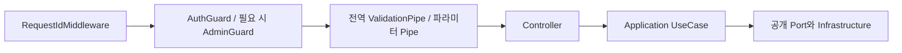

# Shared Presentation Architecture

- 기준일: 2026-10-29
- 대상: [BE/src/shared/presentation](../../../../BE/src/shared/presentation/README.md)
- 목적: 여러 모듈이 공유하는 HTTP 경계의 책임, 등록 위치, 사용 방법을 정의한다.

## 1. 책임과 의존 방향

`shared/presentation`은 요청 인증 연결, HTTP 입력 검증, 요청 컨텍스트 추출, 오류·파일 응답 변환처럼 모듈 공통으로 사용하는 HTTP 처리를 담당한다. NestJS·Express 타입은 이 경계 안에서 사용할 수 있다.

| 위치 | 책임 |
| --- | --- |
| `shared/presentation` | 여러 모듈이 재사용하는 Guard, Pipe, Decorator, Middleware, Filter, HTTP 응답 helper |
| `modules/<module>/presentation` | 해당 도메인의 Controller, 필드형 요청 DTO, 도메인 전용 HTTP 변환 |
| `shared/application` | CurrentUserContext, logger·인증 resolver 등 프레임워크와 분리된 공개 계약 |
| `modules/<module>/application` | Workspace 접근 권한, 참조 무결성, 비즈니스 처리, transaction 경계 |
| `infrastructure` | Prisma·외부 Provider 구현 및 DI 조립 |

- Controller는 HTTP 입력을 검증하고 application use case를 호출한다. Request/Response를 그대로 application에 전달하지 않는다.
- application/domain이 `shared/presentation`이나 Nest HTTP 예외·Express 타입을 import하지 않게 한다. 공통 위치라고 계층 의존 방향이 달라지지 않는다.
- Guard의 사용자 인증과 application의 Workspace·대상 접근 권한 검증은 각각 수행한다. 인증된 사용자라는 사실만으로 대상 Workspace 접근을 허용하지 않는다.
- 공통 Pipe에 View·Record 조회나 DB 보정 같은 비즈니스 로직을 넣지 않는다.

## 2. 현재 파일과 연결 위치

```text
BE/src/shared/presentation/
  README.md
  decorators/current-user.decorator.ts
  guards/auth.guard.ts
  guards/admin.guard.ts
  guards/admin.guard.spec.ts
  middleware/request-id.middleware.ts
  pipes/empty-request.pipe.ts
  filters/http-exception.filter.ts
  http/download-file-response.ts
```

| 구성 | 책임 | 실제 연결 |
| --- | --- | --- |
| [AuthGuard](../../../../BE/src/shared/presentation/guards/auth.guard.ts) | Bearer 토큰을 CurrentUserResolver Port로 전달하고 request.currentUser 설정 | AuthModule에서 provider/export, 필요한 Controller·method의 `@UseGuards(AuthGuard)` |
| [AdminGuard](../../../../BE/src/shared/presentation/guards/admin.guard.ts) | currentUser의 platformRole이 ADMIN인지 확인 | 관리자 API의 `@UseGuards(AuthGuard, AdminGuard)` |
| [CurrentUser](../../../../BE/src/shared/presentation/decorators/current-user.decorator.ts) | 인증된 CurrentUserContext를 Controller 파라미터로 추출 | `@CurrentUser() currentUser: CurrentUserContext` |
| [RequestIdMiddleware](../../../../BE/src/shared/presentation/middleware/request-id.middleware.ts) | 요청 ID를 request와 응답 header에 설정 | AppModule.configure에서 모든 route에 적용 |
| [EmptyRequestPipe](../../../../BE/src/shared/presentation/pipes/empty-request.pipe.ts) | 추가 입력이 없는 API의 Query·Body 검사 | 필요한 파라미터의 `@Query(new EmptyRequestPipe())` / `@Body(new EmptyRequestPipe())` |
| [HttpExceptionFilter](../../../../BE/src/shared/presentation/filters/http-exception.filter.ts) | domain/Nest/기타 예외를 기존 HTTP 오류 envelope로 변환 | main.ts의 `app.useGlobalFilters(...)` |
| [createXlsxDownloadResponse](../../../../BE/src/shared/presentation/http/download-file-response.ts) | 파일 결과를 다운로드 header와 StreamableFile로 변환 | Controller에서 사용할 수 있는 helper. 기준일 현재 BE/src 내 호출부 없음 |

현재 이 폴더 전체를 자동 등록하는 SharedPresentationModule은 없다. 등록 위치는 [main.ts](../../../../BE/src/main.ts), [AppModule](../../../../BE/src/app.module.ts), [AuthModule](../../../../BE/src/modules/auth/infrastructure/auth.module.ts)과 각 Controller를 확인한다. 파일 존재만으로 전역 적용되거나 공개 endpoint가 제공되는 것은 아니다.

## 3. 요청 처리 흐름

본문 파싱을 정상적으로 마친 인증 대상 요청의 주요 흐름은 다음과 같다. CORS 등 HTTP 서버의 세부 단계는 생략했다.



- CurrentUser Decorator는 Guard가 채운 컨텍스트를 추출한다. 스스로 토큰을 검증하거나 누락 사용자를 생성하지 않는다.
- Guard나 Pipe에서 요청이 거부되면 Controller 본문과 업무 use case를 호출하지 않는다. 인증 과정의 resolver 조회와 이후 업무 DB 조회는 구분한다.
- Nest 요청 처리 중 발생한 예외는 등록된 HttpExceptionFilter의 응답 규칙을 따른다.
- Express Request/Response, header, decorator metadata는 presentation에서 다룬다. application에는 CurrentUserContext, 요청 ID 문자열, 검증된 식별자·명령만 전달한다.

## 4. 입력 검증: 필드형 DTO와 빈 요청

### 필드가 있는 요청

모듈의 `presentation/http/dto`에 DTO class를 두고 class-validator로 타입·필수 여부·nullable 등 계약을 표현한다. [Object 생성 DTO](../../../../BE/src/modules/object-definition/presentation/http/dto/create-workspace-object-definition.dto.ts)가 예시다.

main.ts의 현재 전역 ValidationPipe 설정은 `whitelist: true`, `forbidNonWhitelisted: true`, `transform: true`다. 경로 UUID는 Controller에서 `ParseUUIDPipe`를 사용한다. 비즈니스 의미와 Workspace 소속은 application에서 검증한다.

### 추가 입력이 없는 요청

Query/Body에 필드가 전혀 없는 API는 공통 EmptyRequestPipe를 사용한다. 파라미터 선언은 다음과 같다.

```ts
@Query(new EmptyRequestPipe()) _query: unknown,
@Body(new EmptyRequestPipe()) _body: unknown,
```

`unknown`은 검증을 생략한다는 뜻이 아니다. 전역 ValidationPipe가 빈 DTO class로 변환하면서 입력 키를 먼저 제거하지 않게 하고, EmptyRequestPipe가 파싱된 입력을 직접 검증하기 위한 경계 타입이다. 검사 결과는 사용하지 않으므로 Pipe는 void를 반환한다.

| 입력 | 처리 |
| --- | --- |
| 미전송 또는 파싱된 빈 객체 `{}` | 허용 |
| 배열·null·원시값 | HTTP parser 또는 Pipe에서 400 |
| 이름이 있는 Query, 값이 빈 문자열인 Query | 400 |
| 필드가 있는 JSON 객체 | 400 |
| constructor Query, constructor·__proto__ 키를 가진 JSON 객체 | 400 |
| 잘못된 JSON 문법 | 기존 HTTP parser에서 400 |

주의 사항:

- 전역 Pipe가 파라미터 Pipe보다 먼저 실행된다. 파라미터를 빈 DTO class로 되돌리면 전역 변환이 constructor·__proto__ 키를 제거하여 후속 빈 객체 검사가 잘못 성공할 수 있다.
- 검증 대상은 HTTP 서버가 파싱한 Query·Body다. 이 Pipe가 원시 URL/바이트를 재파싱하거나 HTTP parser가 버린 내용을 복원하는 것은 아니다.
- 빈 요청에만 이 방식을 적용한다. 필드형 DTO의 class-validator 검증이나 전역 whitelist 설정을 이 문제 때문에 해제하지 않는다.
- 공통 규칙을 바꿀 때는 [메뉴 Controller](../../../../BE/src/modules/view-definition/presentation/http/user-workspace-view-header-menus.controller.ts)와 [즐겨찾기 Controller](../../../../BE/src/modules/view-definition/presentation/http/user-workspace-view-favorite.controller.ts)의 HTTP 테스트를 함께 확인한다.

## 5. 요청 컨텍스트와 오류 응답

RequestIdMiddleware는 `x-request-id`를 trim하고 길이가 1~128이면 재사용한다. 없거나 비어 있거나 길이를 초과하면 UUID를 생성한다. 같은 값을 request.requestId와 응답 header에 넣으며, Controller는 이 문자열을 use case에 전달한다. Middleware 자체는 업무 성공·실패 로그를 기록하지 않는다.

AuthGuard는 [CurrentUserResolver](../../../../BE/src/shared/application/ports/current-user-resolver.port.ts)를 통해 인증하고 [CurrentUserContext](../../../../BE/src/shared/application/context/current-user.context.ts)를 채운다. AuthModule이 해당 Port를 ResolveCurrentUserUseCase에 연결한다. Guard에서 Prisma나 Supabase 구현을 직접 호출하지 않는다.

| 예외 | 현재 응답 처리 |
| --- | --- |
| DeletedResourceError | 읽기 410 / 변경 409 |
| DomainError | 오류 코드별 상태와 error/message, 허용된 detail만 반환 |
| Nest HttpException | `{ statusCode, error: exception.getResponse() }` |
| 나머지 예외 | 500 / InternalServerError |

DomainError detail은 retryable·field·provider만 선별하며 field가 있으면 code도 응답에 포함한다. 새로운 domain error를 추가할 때는 실제 상태 매핑을 검증한다. 오류 응답 형태를 기능마다 바꾸지 않고 API 계약과 공통 Filter를 함께 확인한다.

운영 로그는 application의 logger Port 등 책임 있는 계층에서 기록한다. 토큰, 비교값·config JSON, 개인정보 원문, DB/Provider 원본 오류를 응답이나 로그에 노출하지 않는다.

## 6. 공통으로 둘지 판단하는 기준

- 여러 모듈이 같은 HTTP 계약을 재사용하고 도메인 지식이 필요 없으면 shared/presentation을 사용한다. EmptyRequestPipe가 이 경우다.
- 한 모듈의 필드·Enum·응답에 종속된 검증과 변환은 해당 모듈의 presentation에 둔다. 다른 모듈이 기능 전용 Pipe를 직접 재사용하게 만들지 않는다.
- Workspace 소속, 필터 그래프, 그룹·옵션 일치, 저장 가능 여부는 application/domain의 책임이다.
- 폴더 이름은 역할을 구분하기 위한 것이다. 모든 모듈에 pipes 폴더를 만들거나 모든 HTTP helper를 무조건 공통화할 필요는 없다.
- 새 class/interface·API method·내부 함수와 주요 흐름은 [주석 규칙](../CONVENTION/COMMENT_AND_LOGGING.md)을 따른다. 형식뿐 아니라 설명이 실제 처리와 일치하는지도 검토한다.

## 7. 검증과 참고

입력 검증을 변경하면 전역 ValidationPipe와 실제 Controller가 연결된 HTTP 테스트로 확인한다. Pipe 단독 호출만으로 decorator metadata·변환 순서의 영향을 검증했다고 보지 않는다.

- 미전송·빈 객체 성공, 일반 필드·예약 키·배열·원시값 거부
- 거부 요청의 업무 use case/DB 호출 차단
- 기존 인증·권한·UUID·성공 상태·오류 envelope 유지
- request ID 전달, 계층 금지 의존성, 필수 주석과 실제 책임 일치

관련 구현 검증은 [빈 요청 검증 보완 기록](../../../../TODO/DONE/VIEW_HEADER_EMPTY_REQUEST_FIX_PLAN/README.md)에 있다. 모듈 경계는 [Modular Monolith 기준](MODULAR_MONOLITH_AND_MSA.md), 계약 작성은 [API Contract](../CONVENTION/API_CONTRACT.md)를 따른다.
