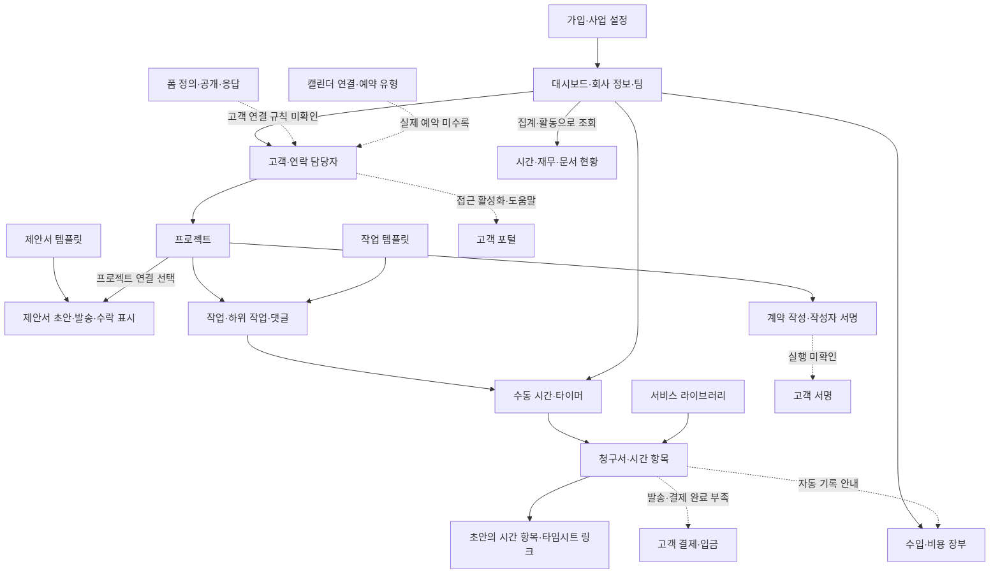

# 전체 업무 흐름과 다음 단계 확인 과제

검토일: 2026-11-18 KST. 대상은 저장된 Bonsai Web Gummble 캡처 **134개 플로우·754단계**와 각 ANALYSIS.md다. 8개 분야별 문서에서 모든 플로우의 진입·변화·도달 상태를 기록했다. F번호는 이번 검토의 참조 번호이며, 원래 Flow ID와 Screen ID는 연결된 원본 분석에 있다.

## 1. 전체 흐름을 어떻게 이해했는가

Bonsai의 업무는 고객과 프로젝트를 중심으로 문서·작업·시간·청구가 연결되고, 계정·팀·포털·예약·폼·회계가 이를 지원한다. 모든 업무가 하나의 필수 순서로 실행되는 것은 아니다. 제안서 없이 프로젝트를 만들 수 있는 화면이 있고, 프로젝트 단계를 바꾸어도 연결 문서가 비어 있는 화면이 있다.

아래 실선은 화면에서 확인한 연결 또는 조작 경로다. 점선은 설정·설명·진입점만 보이거나 실행 결과가 부족한 연결이다. 선은 자동 생성이나 필수 관계를 뜻하지 않는다.

| 업무 묶음 | 확인된 연결과 종료 상태 | 연결의 한계 |
| --- | --- | --- |
| 가입 → 업무 시작 | 가입 폼 → 사업 설문 → 빈 대시보드 → 회사 정보·팀·예약·폼 체크리스트. [F086](01_계정과팀.md#f086), [F087](01_계정과팀.md#f087), [F038](03_고객과대시보드.md#f038) | 이메일 인증·전체 설문 단계·이탈 후 재개는 없음. 체크리스트 완료가 초대 수락이나 외부 연동의 모든 처리를 보장하지 않음 |
| 고객 → 프로젝트 | 고객 상세에서 생성하면 연결 고객이 유지된다. 전역 프로젝트 생성에서는 고객을 고른다. [F003](03_고객과대시보드.md#f003), [F020](03_고객과대시보드.md#f020), [F107](04_프로젝트와작업시간.md#f107) | 생성 경로에 따라 New Lead / In Progress가 달라 고정 초기 상태를 정할 수 없음 |
| 프로젝트 → 문서 | 제안서 생성 중 고객·프로젝트를 고르고 새 프로젝트를 만들 수 있다. 프로젝트에는 문서 상태와 활동이 모인다. [F030](05_제안서와계약서비스.md#f030), [F101](04_프로젝트와작업시간.md#f101), [F113](03_고객과대시보드.md#f113) | 제안서·계약 필수 여부, 동일 프로젝트에 연결 가능한 문서 수, 문서 수정의 전파는 미확인 |
| 프로젝트 → 작업 → 시간 | 작업 담당자·하위 작업·댓글, 수동 1시간과 추가 타이머 7초, 프로젝트별 시간 보고가 보인다. [F095](04_프로젝트와작업시간.md#f095), [F094](04_프로젝트와작업시간.md#f094), [F093](04_프로젝트와작업시간.md#f093), [F097](04_프로젝트와작업시간.md#f097), [F133](04_프로젝트와작업시간.md#f133) | 하위 작업 완료의 부모 전파, 시간 수정·삭제, 동시 타이머, 담당자와 기록자의 권한은 미확인 |
| 시간·서비스 → 청구서 | 서비스 항목 $50과 미청구 시간 $20.04를 더해 $70.04, Drafted 초안에 시간 항목과 Timesheet 링크가 나타난다. [F072](06_청구와회계.md#f072), [F070](06_청구와회계.md#f070) | 초안 포함·Billed 표시·결제 완료를 구분한다. Billed 전환 시점, 반올림·항목 수정·청구 취소 시 시간 복귀는 미확인 |
| 청구 → 입금·장부 | 수입·비용의 별도 입력, 청구서 결제에 대한 장부 자동 기록 안내, Stripe 연결 성공 화면이 있다. [F040](06_청구와회계.md#f040), [F010](06_청구와회계.md#f010), [F078](06_청구와회계.md#f078) | 고객 결제 완료·부분 입금·환불은 없음. Stripe 연결과 정산 성공은 별개 |
| 폼 → 응답 → 고객 | 폼을 구성·공개·공유하고, 제출 성공 및 저장 응답 상세를 볼 수 있다. [F057](07_예약과폼.md#f057), [F059](07_예약과폼.md#f059), [F063](07_예약과폼.md#f063), [F060](07_예약과폼.md#f060), [F061](07_예약과폼.md#f061) | 제출자와 응답 상세의 이름이 달라 동일 응답으로 확정하지 않음. 고객 자동 생성·일치 규칙·질문 버전은 미확인 |
| 캘린더 → 예약 유형 | Google Calendar 연결 표시 → 길이·가용 시간·충돌 달력·알림·테마 설정 → Event Type Created. [F043](07_예약과폼.md#f043)–[F048](07_예약과폼.md#f048) | 실제 슬롯 선택·예약 확정·변경·취소는 수록되지 않음 |
| 템플릿 → 실제 업무 | 빈 작업 템플릿 → 구성 작업·파일·하위 작업 → 프로젝트에 제목이 같은 카드 생성. [F130](04_프로젝트와작업시간.md#f130), [F131](04_프로젝트와작업시간.md#f131), [F128](04_프로젝트와작업시간.md#f128) | 파일·하위 작업의 전체 복제 결과와 이후 원본 변경 반영은 미확인 |
| 외부 고객 접근 | 전역 Portal Access 활성화와 캡처된 포털 도움말, 문서/청구서 미리보기가 있다. [F022](03_고객과대시보드.md#f022), [F066](08_공개사이트와지원.md#f066), [F075](06_청구와회계.md#f075) | 고객으로 접속해 자신의 실제 자료를 읽거나 권한을 검증한 화면은 부족 |

## 2. 상태를 합치면 안 되는 지점

| 대상 | 화면에서 구분되는 상태·행동 | 근거와 주의점 |
| --- | --- | --- |
| 계정·팀 | 계정 생성, 초대 발송, Invite Pending, 초대 수락, 프로젝트 배정, 제거 | [F068](01_계정과팀.md#f068)의 초대 성공과 [F002](01_계정과팀.md#f002)의 협업자 진입을 구분. [F123](01_계정과팀.md#f123)의 제거 대상은 초대 대기자 |
| 제안서 | 초안, 발송, 수동 수락 표시, 보관 | [F036](05_제안서와계약서비스.md#f036) 발송 후 [F035](05_제안서와계약서비스.md#f035)의 Mark Accepted는 내부 사용자의 조작. 고객의 실제 수락 경로는 없음. [F031](05_제안서와계약서비스.md#f031) 보관 뒤에도 Accepted 표시 유지 |
| 계약 | 작성·편집, Standardized → Fully Editable, 작성자 서명, Finalized, 발송 진입 | [F029](05_제안서와계약서비스.md#f029)에서 작성자 서명과 Finalized가 보이지만 고객 서명은 비어 있음. 양측 서명 완료로 표시하지 않음 |
| 프로젝트 | 진행 단계, 완료, 보관, 삭제 | [F104](04_프로젝트와작업시간.md#f104)의 Proposal Sent에서도 문서는 비어 있음. [F108](04_프로젝트와작업시간.md#f108)의 Contract Signed 이동은 실제 계약 서명과 다름 |
| 작업 | 상태 정의, 작업의 상태, 하위 작업 체크, 보관, 삭제 | [F100](04_프로젝트와작업시간.md#f100)은 상태 색상 정의 편집. [F096](04_프로젝트와작업시간.md#f096) 보관 작업과 [F098](04_프로젝트와작업시간.md#f098) 삭제 작업은 서로 다른 대상 |
| 시간 | 타이머 실행·일시정지·완료, 미청구, 초안 포함, 청구됨 | [F125](04_프로젝트와작업시간.md#f125)에서 패널을 닫아도 타이머가 진행. [F070](06_청구와회계.md#f070)은 Drafted 초안의 시간 항목까지 확인. [F041](03_고객과대시보드.md#f041)·[F002](01_계정과팀.md#f002)의 Billed 표시는 별도로 관찰되며 그 전환 조작·시점과 실제 대금 수령은 미확인 |
| 청구·결제 | Drafted, 예정 주기, 발송 설정, 결제수단 연결, 입금 기록, 결제 완료 | [F074](06_청구와회계.md#f074) 자동 발송은 날짜 오류, [F076](06_청구와회계.md#f076) 입금 기록은 카드 결제 활성화 요구에서 종료. 둘 다 성공 사례가 아님 |
| 공개 설정 | 고객 Active, 고객 포털 Enabled, 회사 공개 프로필, Client/Dual Mode | [F022](03_고객과대시보드.md#f022)·[F118](02_설정과구독.md#f118)·[F121](02_설정과구독.md#f121)은 각각 별도 설정. 하나를 켜고 끈 결과를 다른 기능에 전파하지 않음 |
| 폼 | 정의 편집, 게시 설정, 링크/이메일 공유, 제출, 응답 조회 | [F063](07_예약과폼.md#f063)의 sent는 수신·열람이 아님. [F060](07_예약과폼.md#f060)의 제출 성공과 [F061](07_예약과폼.md#f061)의 응답을 ID 없이 동일 건으로 합치지 않음 |
| 제품 구독 | 플랜 선택, 카드 등록/처리, 구독 반영, 기간 말 해지 예약 | [F126](02_설정과구독.md#f126)·[F127](02_설정과구독.md#f127)은 Bonsai 이용료. 고객에게 보내는 반복 청구 [F071](06_청구와회계.md#f071)과 구분 |
| 외부 연결 | 연결 동의 진입, 인증, 연결됨, 이용 설정, 실제 처리 | [F014](06_청구와회계.md#f014)는 Plaid Continue에서 끝남. [F078](06_청구와회계.md#f078) Stripe 연결 성공 뒤 [F079](06_청구와회계.md#f079)에서 카드 결제를 꺼도 연결 정보는 남음 |
| 파일·브랜딩 | 선택, 미리보기, 하위 항목 저장, 전체 설정 저장 | [F039](03_고객과대시보드.md#f039) 로고 미리보기와 [F038](03_고객과대시보드.md#f038) 회사 전체 저장을 구분. [F119](02_설정과구독.md#f119) 새 문서 기본값과 [F081](06_청구와회계.md#f081) 청구서 설정의 적용 안내도 다름 |

## 3. 기능군 21개의 화면 근거와 빈 곳

기능군 이름은 [기존 기능 지도](../../CRM_Bonsai_기능지도와_확인사항.md)의 P01–P21을 유지한다. 아래의 부족한 근거는 제품에 기능이 없다는 뜻이 아니다. 모든 저장 화면을 검토했어도 최신 Bonsai 전체 기능의 재현 명세가 완성된 것은 아니다.

| ID | 기능군 | 이번 화면 근거 | 다음 단계에서 채울 내용 |
| --- | --- | --- | --- |
| P01 | 가입·계정·업무 공간·팀·권한 | [F086](01_계정과팀.md#f086), [F087](01_계정과팀.md#f087), [F068](01_계정과팀.md#f068), [F002](01_계정과팀.md#f002), [F123](01_계정과팀.md#f123) | 현행 역할별 접근, 여러 업무 공간, 기존 계정의 초대 수락, 제거 후 접근 |
| P02 | 고객 회사·담당자·활동·메모 | [F003](03_고객과대시보드.md#f003), [F021](03_고객과대시보드.md#f021), [F019](03_고객과대시보드.md#f019), [F023](03_고객과대시보드.md#f023) | 추가 연락 담당자·기본 담당자, 중복, 공유/비공개 메모, 고객 삭제 |
| P03 | 거래·파이프라인·후속 작업 | [F106](04_프로젝트와작업시간.md#f106), [F104](04_프로젝트와작업시간.md#f104), [F108](04_프로젝트와작업시간.md#f108)의 프로젝트 단계 | 독립 거래 기능·단계 정의·성사/실패·프로젝트 전환. 프로젝트 보드만으로 거래 모델을 확정하지 않음 |
| P04 | 서비스·단가표·견적 계산 | [F115](05_제안서와계약서비스.md#f115), [F114](05_제안서와계약서비스.md#f114), [F072](06_청구와회계.md#f072), [F030](05_제안서와계약서비스.md#f030) | 현행 Estimate, 요율표, 원가·할인·세금, 문서로 가져오기. 과거 Proposal과 구분 |
| P05 | 제안·계약·문서·템플릿·서명 | [F030](05_제안서와계약서비스.md#f030)–[F037](05_제안서와계약서비스.md#f037), [F026](05_제안서와계약서비스.md#f026)–[F029](05_제안서와계약서비스.md#f029) | 새 Document Builder와 이전 문서 경험, 수신자·버전·재발송·서명 완료 |
| P06 | 프로젝트·상태·파일·협업 | [F020](03_고객과대시보드.md#f020), [F101](04_프로젝트와작업시간.md#f101)–[F109](04_프로젝트와작업시간.md#f109) | 완료/보관/복원·공유 파일·팀 접근·설명/내부 노트 범위 |
| P07 | 작업·하위 작업·반복·일정·Gantt | [F092](04_프로젝트와작업시간.md#f092)–[F100](04_프로젝트와작업시간.md#f100), [F128](04_프로젝트와작업시간.md#f128)–[F131](04_프로젝트와작업시간.md#f131) | 반복 설정 실행·의존 관계·달력/Gantt·중첩 깊이. 반복 메뉴 존재만 확인 |
| P08 | 시간 기록·타임시트 | [F093](04_프로젝트와작업시간.md#f093), [F097](04_프로젝트와작업시간.md#f097), [F125](04_프로젝트와작업시간.md#f125), [F133](04_프로젝트와작업시간.md#f133), [F070](06_청구와회계.md#f070) | 수정/삭제·동시 타이머·다중 통화·청구 취소·시간/금액 반올림 |
| P09 | 예산·비용·수익성 | [F010](06_청구와회계.md#f010), [F017](06_청구와회계.md#f017), [F101](04_프로젝트와작업시간.md#f101), [F041](03_고객과대시보드.md#f041) | 실제 예산·원가·수익성 산식·비용 재청구. 청구 단가를 원가로 보지 않음 |
| P10 | 인력 배정·워크로드·휴가 | [F068](01_계정과팀.md#f068), [F101](04_프로젝트와작업시간.md#f101)의 팀 배정 수준 | 가용량·워크로드·휴가 전용 화면 없음. Careers의 휴가 소개는 근거가 아님 |
| P11 | 청구서·항목·입금·잔액 | [F071](06_청구와회계.md#f071)–[F081](06_청구와회계.md#f081), [F070](06_청구와회계.md#f070) | 실제 발송·전액/부분 입금·취소·실패·환불·잔액 계산 |
| P12 | 반복 청구·구독·리테이너 | [F071](06_청구와회계.md#f071)의 Subscription 주기·종료일 | 반복 발행/자동 발송/자동 결제/리테이너 차이와 실행 이력 |
| P13 | 고객 포털·공유·브랜딩 | [F022](03_고객과대시보드.md#f022), [F066](08_공개사이트와지원.md#f066), [F119](02_설정과구독.md#f119), [F081](06_청구와회계.md#f081), [F075](06_청구와회계.md#f075) | 실제 고객 접속·자료 공개 범위·여러 담당자·접근 철회·브랜딩 적용 우선순위 |
| P14 | 문의 양식·상담 예약 | [F042](07_예약과폼.md#f042)–[F052](07_예약과폼.md#f052), [F057](07_예약과폼.md#f057)–[F063](07_예약과폼.md#f063), [F111](07_예약과폼.md#f111)–[F112](07_예약과폼.md#f112) | 실제 예약·시간대·변경/취소, 응답 수정·중복·스팸·고객 연결 |
| P15 | 필드·보기·검색·가져오기/내보내기 | [F019](03_고객과대시보드.md#f019), [F109](04_프로젝트와작업시간.md#f109), [F113](03_고객과대시보드.md#f113), [F122](02_설정과구독.md#f122), [F013](06_청구와회계.md#f013), [F016](06_청구와회계.md#f016), [F017](06_청구와회계.md#f017) | 필드 자료형·저장 보기·정렬 저장·CSV 부분 성공/실패·파일 내용 |
| P16 | 알림·이메일·캘린더·활동 기록 | [F120](02_설정과구독.md#f120), [F043](07_예약과폼.md#f043), [F044](07_예약과폼.md#f044), [F045](07_예약과폼.md#f045), [F041](03_고객과대시보드.md#f041) | 실제 발송/수신·중복 동기화·재연결·활동 주체/시각·개인 설정 우선순위 |
| P17 | 자동화·워크플로 | [F033](05_제안서와계약서비스.md#f033), [F021](03_고객과대시보드.md#f021), [F101](04_프로젝트와작업시간.md#f101) | 트리거 선택 완료·실제 실행·실패/재시도·버전별 지원. 성공 토스트만으로 실행 검증 안 됨 |
| P18 | 보고서·대시보드·내보내기 | [F041](03_고객과대시보드.md#f041), [F011](06_청구와회계.md#f011), [F012](06_청구와회계.md#f012), [F133](04_프로젝트와작업시간.md#f133) | 집계 기간·포함 상태·통화·손익 산식·재무 권한·내보내기 일치 |
| P19 | 외부 연동·공개 API·MCP·AI | [F116](02_설정과구독.md#f116)·[F122](02_설정과구독.md#f122)의 연동 카드 12개, [F043](07_예약과폼.md#f043), [F078](06_청구와회계.md#f078), [F014](06_청구와회계.md#f014) | 카드 안내와 실제 연결·실행은 구분. 각 연동 범위와 해제, 공개 API·MCP·AI·Webhook은 추가 조사 |
| P20 | 설정·요금제·계정 구독·지역 기능 | [F116](02_설정과구독.md#f116)–[F127](02_설정과구독.md#f127), [F089](08_공개사이트와지원.md#f089) | 현행 가격·플랜·국가·Tax/금융 제공 범위·좌석·해지/일시정지 |
| P21 | 반응형·접근성·모바일 경로 | [F053](03_고객과대시보드.md#f053) 사이드바 축소, [F113](03_고객과대시보드.md#f113) 단축키 안내, 데스크톱 화면 | 모바일·반응형 breakpoint·키보드 실동작·포커스·스크린 리더·중단 후 복귀 |

## 4. UI에서 반복되는 구조와 예외

- **진입 문맥:** 전역 +New, 목록의 New, 프로젝트/고객 상세의 +가 함께 있다. 고객 문맥이 고정되는 생성과 고객을 선택하는 생성, 전역 작업 목록과 프로젝트 내부 목록을 구분한다.
- **보기와 상세:** 프로젝트/작업 보드, 프로젝트 표, 날짜별 시간 표, 오른쪽 작업 패널, 가운데 모달, 문서 편집기, 공개 제출 페이지가 각각 다른 작업 깊이를 가진다. 전역 검색 결과는 객체 종류별 상태·금액·연결 이름을 함께 보여준다.
- **동일 모양의 조작도 범위가 다름:** 카드 메뉴와 열 메뉴, 작업 상태 선택과 상태 정의 편집, 브랜드 기본값과 개별 문서 스타일을 구분한다. 드래그 캡처 하나로 같은 열 안의 정렬 저장까지 검증한 것으로 보지 않는다.
- **저장 단위:** 주소 부분 Save와 회사 전체 Save, 하위 작업 Save와 템플릿 Save Task가 따로 있다. 일부 토글·태그에는 즉시 성공 토스트가 보이지만 모든 필드가 같은 방식으로 자동 저장된다고 일반화할 수 없다.
- **입력 오류:** 가입 길이 말풍선, 비밀번호 재설정 본문 오류, 청구 항목 이름 오류, 반복 비용의 양수 검증, 폼 필수 오류, CSV 행별 오류가 다르다. 버튼 색·입력 변경만으로 검증 성공을 판단하지 않는다.
- **진행과 성공:** 로딩 오버레이·처리 중·필드 미리보기·저장 토스트·목록 행 생성·외부 결과를 구분한다. 클립보드 토스트는 실제 클립보드 내용 검증이 아니며, 다운로드 준비는 파일 내용 검증이 아니다.
- **빈 상태와 필터:** 온보딩의 회색 샘플, 템플릿의 설명 그림, 필터 적용 후 0건, 보관 후 기본 목록에서 사라진 항목은 의미가 다르다. 빈 목록을 데이터 영구 삭제의 증거로 쓰지 않는다.
- **공개/내부 영역:** 내부 프로젝트 노트, 고객에게 보이는 설명, 회사 공개 프로필, 고객 포털, 문서 미리보기, 실제 고객 응답 페이지는 접근 대상이 다르다. 미리보기로 고객 권한을 검증할 수 없다.
- **날짜·시간·돈:** 01:00:07과 1.00 Hours는 표현 정밀도가 다르다. 2월 7일 시간은 2월 6일까지의 보고서에 없어도 모순이 아니다. Due 열의 금액과 기한 날짜, 청구 단가와 기록 금액, 연 결제의 월 환산가와 결제 총액도 구분한다.
- **브랜드 적용 범위:** [F119](02_설정과구독.md#f119)에는 새 문서 적용, [F080](06_청구와회계.md#f080)에는 이후 생성 청구서 기본값, [F081](06_청구와회계.md#f081)에는 기존/미래 청구서 관련 안내가 보인다. 통합된 단일 소급 반영 규칙으로 정하지 않는다.
- **권한 표현:** Owner/Partner와 Collaborator의 사이드바·문서/금액 노출 차이는 관찰됐지만 직접 URL·외부 요청의 접근 차단은 검증하지 않았다. UI 숨김과 실제 권한은 후속 확인이 필요하다.
- **마케팅 화면:** 공개 랜딩의 대시보드 모형, 카드의 후기·예시 고객, 채용 혜택, 제휴 프로그램은 제품 안에서 실행한 업무 데이터와 분리해서 읽는다.

## 5. 재검토에서 발견한 정정·불연속

| 근거 | 관찰과 보정 | 해석에 미치는 영향 |
| --- | --- | --- |
| [F070](06_청구와회계.md#f070) 04–05 / [F041](03_고객과대시보드.md#f041) / [F002](01_계정과팀.md#f002) | 시간 추가 후에도 청구서는 Drafted. 다른 흐름의 Billed 표시와 그 사이 조작은 이어져 있지 않음 | 업무 연결도의 ‘청구됨’ 표현을 ‘초안의 시간 항목·타임시트 링크’로 정정. 초안 포함이 Billed 전환 조건이라는 규칙을 만들지 않음 |
| [F081](06_청구와회계.md#f081) 02→03–05 | Foundation 미리보기 다음에 Studio 형태가 다시 보이며 되돌리는 조작이 없음. 팁 체크 후 저장 성공은 확인 | Foundation 최종 저장으로 단정하지 않고 레이아웃 복귀의 불연속과 저장 후 재조회 부재를 기록 |
| [F122](02_설정과구독.md#f122) 02–03 | 하단 Google Sheets·Xero·Hubspot 카드와 Request an integration 링크를 분석에 추가 | F116 상단 카드 9개를 설정의 전체 연동 목록으로 읽지 않도록 보완. 카드의 설명은 실행 증거가 아님 |
| [F054](03_고객과대시보드.md#f054) 01→02 | Unbilled 06:01:16 / $120.42 → 08:01:16 / $160.42. 기존 분석의 금액 유지 설명과 다름 | 이미지 값을 우선한다. 중간 기록이 없어 작업 완료가 자동으로 2시간을 더한다고 해석하지 않음 |
| [F108](04_프로젝트와작업시간.md#f108) | 이름 Reordering이지만 실제로 In Progress → Contract Signed 열 이동 | 열 내부 순서 저장이나 실제 계약 서명을 확인한 것이 아님 |
| [F099](04_프로젝트와작업시간.md#f099) | 하위 작업의 완료와 담당자 변경이 보임 | 이름 편집 완료로 기록하지 않음 |
| [F112](07_예약과폼.md#f112) | 예약 링크 복사와 요금제 제한 화면 | 예약 페이지 복제 완료가 아님 |
| [F074](06_청구와회계.md#f074) / [F076](06_청구와회계.md#f076) / [F122](02_설정과구독.md#f122) / [F121](02_설정과구독.md#f121) | 자동 발송 오류 / 입금 기록 제한 / CSV 오류 / 모드 전환 요금제 화면 | 플로우 이름에 기능명이 있어도 실행 성공 목록에 넣지 않음 |
| [F134](08_공개사이트와지원.md#f134) | 청구서 생성기의 항목·세금 계산 후 가입 화면 | PDF 다운로드 완료로 취급하지 않음 |
| [F029](05_제안서와계약서비스.md#f029) | 작성자 서명·Finalized 표시, 고객 서명 공란 | 양측 합의/서명 완료가 아님 |
| [F020](03_고객과대시보드.md#f020) / [F107](04_프로젝트와작업시간.md#f107) | 고객 상세 생성은 New Lead, 보드 생성은 In Progress | 최초 프로젝트 상태의 선택·기본 규칙 미확인 |
| [F037](05_제안서와계약서비스.md#f037) / [F036](05_제안서와계약서비스.md#f036) | 별도 만료일 설정과 발송 창의 7일 설정, 발송 뒤 만료일이 다름 | 두 입력의 우선순위와 재계산 규칙은 공식 확인 필요 |
| [F057](07_예약과폼.md#f057) / [F060](07_예약과폼.md#f060) / [F061](07_예약과폼.md#f061) | 편집 중 추가된 짧은 텍스트 질문이 공개/응답 화면에서 보이지 않음 | 삭제·버전 변경·다른 시점일 수 있어 동일 정의의 완전한 전파로 주장하지 않음 |
| [F060](07_예약과폼.md#f060) / [F061](07_예약과폼.md#f061) | 공개 제출의 이름과 저장 응답 상세의 이름이 다름 | 같은 이메일만으로 동일 제출·고객 자동 매칭을 확정하지 않음 |
| [F010](06_청구와회계.md#f010) | 비용 입력일과 목록 표시일이 하루 다름 | 시간대나 변환 규칙을 임의로 결정하지 않음 |
| [F053](03_고객과대시보드.md#f053) / [F101](04_프로젝트와작업시간.md#f101) / [F102](04_프로젝트와작업시간.md#f102) | 축소·탭 이동·이름 편집 사이에 날짜·작업 수·이름이 추가로 달라짐 | 화면 순서는 보존하되 모든 차이를 직전 클릭의 효과로 만들지 않음 |
| [F064](08_공개사이트와지원.md#f064) / [F067](08_공개사이트와지원.md#f067) / [F055](08_공개사이트와지원.md#f055) / [F069](08_공개사이트와지원.md#f069) | Freelancers 흐름에 Small businesses 제목, 일부 기능 카드 제목·본문 불일치 | 탐색 분류·홍보 문구와 실제 업무 개념을 구분 |
| [F087](01_계정과팀.md#f087) / [F082](08_공개사이트와지원.md#f082) / [F089](08_공개사이트와지원.md#f089) / [F004](08_공개사이트와지원.md#f004) | 체험 기간·가격·보상 설명이 시점/문맥별로 다르거나 관계가 불분명 | 현재 정책을 이 캡처들로 합성하지 않음 |

원본 ANALYSIS.md는 보존했다. 위 표와 분야별 재검토가 이번 1단계의 보완 기록이다. 이후 명세 작성 때 원본 문장만 복사하지 않고 해당 화면과 이 보정을 함께 읽는다.

## 6. 2단계 공식 문서 조사에서 먼저 해결할 질문

질문은 화면에서 얻은 공백을 채우기 위한 것이다. 여기서 임의로 정책·필수 관계·개수 제한을 결정하지 않는다.

| 순서 | 확인할 질문 | 화면 근거 |
| --- | --- | --- |
| 1 | 현재 계정/버전에서 Proposal·Contract·Estimate·Document Builder는 어떻게 구분되고 서로 전환되는가? 이전 캡처와 현행 문서의 차이는 무엇인가? | [F026](05_제안서와계약서비스.md#f026)–[F037](05_제안서와계약서비스.md#f037), [F114](05_제안서와계약서비스.md#f114)–[F115](05_제안서와계약서비스.md#f115) |
| 2 | 고객 회사·연락 담당자·내부 회사·멤버·프로젝트는 어떤 관계와 접근 범위를 가지는가? 포털 접근과 초대·제거는 어떻게 달라지는가? | [F003](03_고객과대시보드.md#f003), [F019](03_고객과대시보드.md#f019)–[F023](03_고객과대시보드.md#f023), [F068](01_계정과팀.md#f068), [F002](01_계정과팀.md#f002), [F123](01_계정과팀.md#f123) |
| 3 | 영업 거래/프로젝트 단계·문서 발송/수락/서명·완료/보관은 어떤 사건으로 바뀌는가? 수동 변경과 자동 변경을 구분할 수 있는가? | [F104](04_프로젝트와작업시간.md#f104), [F108](04_프로젝트와작업시간.md#f108), [F035](05_제안서와계약서비스.md#f035), [F029](05_제안서와계약서비스.md#f029), [F031](05_제안서와계약서비스.md#f031) |
| 4 | 서비스·견적·문서·청구서로 복사할 때 값과 연결이 어떻게 유지되는가? 원본 수정·재발송·템플릿 재적용은 무엇에 영향을 주는가? | [F030](05_제안서와계약서비스.md#f030), [F072](06_청구와회계.md#f072), [F114](05_제안서와계약서비스.md#f114), [F128](04_프로젝트와작업시간.md#f128), [F131](04_프로젝트와작업시간.md#f131) |
| 5 | 초 단위 시간과 요율·금액을 어디에서 반올림하는가? 미청구→청구됨·청구 취소·부분 입금·환불은 어떻게 연결되는가? | [F093](04_프로젝트와작업시간.md#f093), [F097](04_프로젝트와작업시간.md#f097), [F133](04_프로젝트와작업시간.md#f133), [F070](06_청구와회계.md#f070), [F076](06_청구와회계.md#f076) |
| 6 | 반복 발행·자동 발송·자동 결제·리테이너·제품 이용 구독의 주기/실패/중단 조건은 각각 무엇인가? | [F071](06_청구와회계.md#f071), [F074](06_청구와회계.md#f074), [F075](06_청구와회계.md#f075), [F126](02_설정과구독.md#f126), [F127](02_설정과구독.md#f127) |
| 7 | 비용의 반복·재청구·세금 분류와 수입의 출처·집계 기준은 무엇인가? 예산·원가·수익성 기능은 어디까지 제공되는가? | [F010](06_청구와회계.md#f010), [F013](06_청구와회계.md#f013), [F017](06_청구와회계.md#f017), [F040](06_청구와회계.md#f040), [F041](03_고객과대시보드.md#f041) |
| 8 | 폼 게시 버전과 응답은 어떻게 연결되고, 고객 생성/매칭·파일·중복 제출을 어떻게 처리하는가? | [F057](07_예약과폼.md#f057), [F059](07_예약과폼.md#f059)–[F063](07_예약과폼.md#f063) |
| 9 | 예약의 시간대·충돌·버퍼·취소/재예약·알림은 어떻게 동작하는가? 캘린더 연결 해제/실패 때는 어떻게 되는가? | [F043](07_예약과폼.md#f043)–[F048](07_예약과폼.md#f048), [F111](07_예약과폼.md#f111)–[F112](07_예약과폼.md#f112) |
| 10 | 사용자 필드·보기·검색·CSV는 어떤 대상·자료형·정렬·오류 단위를 지원하는가? 부분 저장과 재시도 동작은 무엇인가? | [F019](03_고객과대시보드.md#f019), [F109](04_프로젝트와작업시간.md#f109), [F113](03_고객과대시보드.md#f113), [F122](02_설정과구독.md#f122), [F013](06_청구와회계.md#f013), [F016](06_청구와회계.md#f016) |
| 11 | 자동화가 지원하는 트리거/동작과 문서 버전 제한은 무엇인가? 실행 이력·오류·중복 실행을 어떻게 다루는가? | [F033](05_제안서와계약서비스.md#f033), [F021](03_고객과대시보드.md#f021), [F101](04_프로젝트와작업시간.md#f101) |
| 12 | 작업 반복·의존/Gantt·인력 가용량/휴가·현행 보고서·공개 API/MCP/AI 등 캡처 부족 영역은 어떤 기능을 갖는가? | P07, P09, P10, P18, P19의 공백 |
| 13 | 보관·삭제·계정 종료 후 문서/시간/댓글/결제 이력과 외부 접근은 어떻게 유지되는가? | [F096](04_프로젝트와작업시간.md#f096), [F098](04_프로젝트와작업시간.md#f098), [F117](02_설정과구독.md#f117), [F123](01_계정과팀.md#f123), [F127](02_설정과구독.md#f127) |
| 14 | 현재 플랜·국가·결제 제공자·좌석·브랜딩·모바일/접근성 조건은 무엇인가? | [F089](08_공개사이트와지원.md#f089), [F119](02_설정과구독.md#f119), [F121](02_설정과구독.md#f121), [F126](02_설정과구독.md#f126)–[F127](02_설정과구독.md#f127), P21 |

공식 문서로도 답이 없는 항목은 실제 계정에서 확인해야 할 질문으로 남긴다. 자료를 찾지 못한 사실과 기능이 없는 사실을 구분하고, 공개 API의 외부 계약을 내부 저장 구조로 간주하지 않는다.

## 7. 이번 검토의 완료 범위

- 저장된 모든 플로우의 모든 이미지와 기존 분석을 읽었다. 중복 이미지도 해당 플로우의 앞뒤 문맥에서 다시 확인했다.
- 각 흐름의 입력·전후 변화·종료 상태·공백을 분야별로 남겼다. 순서대로 캡처됐다는 사실과 모든 중간 조작이 수록됐다는 주장을 구분했다.
- 긴 공개 페이지·약관·영상은 저장된 장면만 검토했다. 페이지 전체 본문, 동영상 재생, 다운로드 파일, 네트워크 호출, 실계정의 권한·발송·결제 결과까지 검증한 것은 아니다.
- 공식 도움말·REST API 인용은 기존 조사 기록으로 읽었다. 이번 단계에서 공식 사이트나 Gummble의 최신 목록을 새로 조회한 것으로 표시하지 않는다.
- 다음 작업은 **2단계 공식 문서 대조**다. 화면 근거와 공식 설명을 합친 전체 기능·데이터 요구는 3단계에서 정리하고, 기존 DB와의 비교·스키마 변경은 4단계에서 진행한다.

